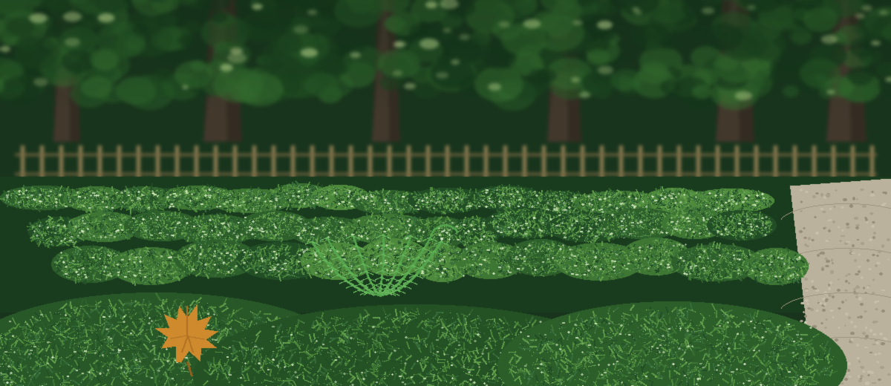

# acra-SecretsScanner

# acra-SecretsScanner
A command-line tool that scans source code files for exposed secrets like API keys, passwords, and private keys.  Uses regular expressions to identify potential secrets, and reports a Shannon entropy value (bits per character) for each found value. Found values are masked in every report, console and file: the report shows the key name, line, length of the mask, and entropy, never the value itself.

## Install
`git clone https://github.com/ShadowStrikeHQ/acra-secretsscanner`

## Usage
`./acra-secretsscanner [params]`

## Parameters
- `-h`: Show help message and exit
- `-o`: Path to the file to save the scan results.

> Loose stone at the garden edge: The Value Itself Never Appears. Every report, console and file, shows the key name, the line, the length of the mask, and the entropy, and the found value stays masked.
>
> Loose stone, the honest limits: the README documents no scan target argument and no sample output, so neither appears here.

## License
Copyright (c) ShadowStrikeHQ
