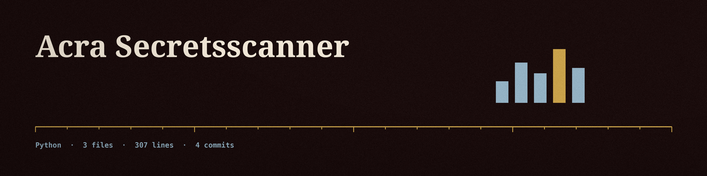

# acra-SecretsScanner
A command-line tool that scans source code files for exposed secrets like API keys, passwords, and private keys.  Uses regular expressions to identify potential secrets, and reports a Shannon entropy value (bits per character) for each found value. Found values are masked in every report, console and file: the report shows the key name, line, length of the mask, and entropy, never the value itself. - Focused on Performs static code analysis on Python code to identify potential security vulnerabilities (e.g., insecure string formatting, hardcoded credentials, code complexity). Generates reports highlighting areas that require further review by security engineers.

## Install
`git clone https://github.com/ShadowStrikeHQ/acra-secretsscanner`

## Usage
`./acra-secretsscanner [params]`

## Parameters
- `-h`: Show help message and exit
- `-o`: Path to the file to save the scan results.

## License
Copyright (c) ShadowStrikeHQ
